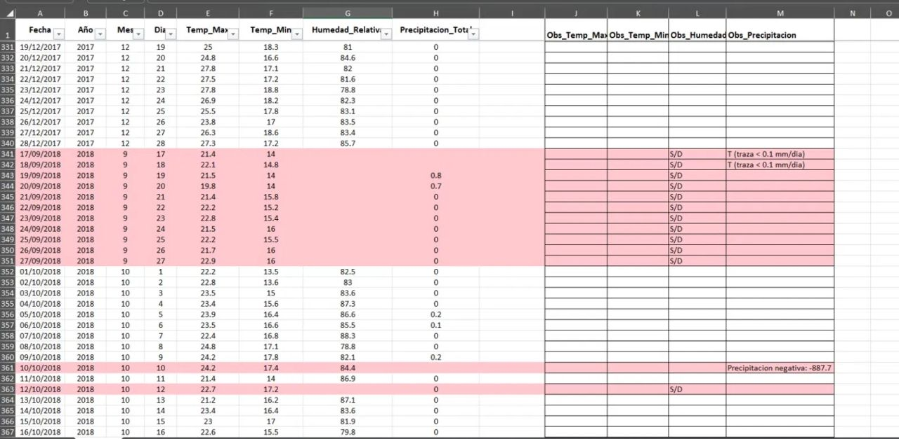

# Limpieza de datos meteorológicos SENAMHI con Excel y Python

**Johan Manuel Villar Turpo · Proyecto de aprendizaje en Ingeniería Ambiental**

Este proyecto reúne dos formas que exploré para limpiar y consolidar datos diarios de estaciones meteorológicas: una macro de Excel y un script de Python. El objetivo fue reducir el trabajo repetitivo de revisar tablas y dejar observaciones junto a los datos que necesitan atención.

## Dos formas de trabajar

| | Excel / VBA | Python |
|---|---|---|
| Entrada | Tabla pegada en una hoja | Archivos CSV distribuidos en carpetas |
| Proceso | Ejecutar la macro sobre la hoja activa | Recorrer las subcarpetas y leer las descargas |
| Salida | Acumular registros en la hoja Maestro | Crear un Excel por carpeta de estación |
| Herramientas | Excel y VBA | Python, pandas y openpyxl |

Ambas versiones revisan S/D, trazas, valores centinela como −999, precipitación negativa y humedad fuera de 0–100 %. Python también marca los días en que la temperatura máxima es menor que la mínima.

## Un caso real: precipitación negativa

En la descarga de FONAGRO (CHINCHA), código **000791**, aparece **−887,7 mm/día el 10 de octubre de 2018**. Ese valor ya estaba en el CSV de SENAMHI: el programa lo detecta, deja vacía la celda numérica y registra el valor negativo en la observación. El archivo disponible no permite determinar la causa del registro.



La fila puede comprobarse en [la descarga de octubre de 2018](ejemplo/FONAGRO/2018/table%20%281%29.csv).

## Archivos

- [Macro VBA](excel/SENAMHI_Macro.bas): código legible de la versión Excel.
- [Libro original](excel/Scrip.xlsm): archivo conservado con macros y las hojas Hoja5, Config y Maestro.
- [Script Python original](python/senamhi_consolidar.py): copia sin cambios del programa utilizado.
- [Lanzador](ejecutar_python.py): añadido al organizar el portafolio para elegir las carpetas sin editar las rutas del original.
- [Datos de ejemplo](ejemplo/FONAGRO/2018): cuatro CSV con su metadata y leyenda.
- [Guía de Excel](docs/uso-excel.md) y [revisión de Python](docs/revision-python.md): instrucciones y alcance de cada versión.

## Probar Python

Descargar el repositorio completo con **Code > Download ZIP** y extraerlo. El lanzador necesita la carpeta `python` junto a él; descargar solamente un archivo no incluye todo el proyecto. Para probar las descargas propias de FONAGRO, seguir [esta guía paso a paso](docs/prueba-fonagro.md).

Desde una terminal abierta en la carpeta del proyecto:

```shell
python -m pip install -r requirements.txt
python ejecutar_python.py
```

El lanzador utiliza los CSV de `ejemplo` y guarda el resultado en `resultados`. Para otras carpetas:

```shell
python ejecutar_python.py --entrada "C:/mis-datos/estaciones" --salida "C:/mis-resultados"
```

La entrada debe contener una subcarpeta por estación, con sus CSV directamente dentro o distribuidos por años. Los CSV pueden abrirse con Excel, pero el script no lee archivos .xlsx ni .xlsm como entrada. La salida debe quedar fuera de la entrada. Las dependencias fijadas corresponden al entorno utilizado en la revisión.

## Qué conserva esta publicación

El código VBA, el libro Excel y el script Python son las versiones históricas conservadas. El lanzador y esta documentación se añadieron al preparar el portafolio. El Excel generado con el ejemplo es una reproducción actual y queda excluido de Git mediante `.gitignore`.

Las versiones omiten fechas repetidas sin resolver las diferencias entre registros. La lectura del nombre supone que la etiqueta y el nombre están en celdas distintas; los CSV de ejemplo los contienen en una misma celda. En Python se termina usando el nombre de la carpeta. Estas limitaciones están documentadas: no se presenta la herramienta como una validación completa ni como un sistema que conserva todos los duplicados.

Al ordenar las descargas se encontraron cinco CSV en una carpeta llamada “Socsi CANETE” cuya metadata corresponde a FONAGRO. No se incluyeron como datos de Socsi. La muestra de este proyecto corresponde a FONAGRO según su metadata.

## Fuente y aprendizaje

Los CSV identifican como fuente a **SENAMHI / DRD** e indican que son datos sin control de calidad. Se conserva esa advertencia y la leyenda original en cada archivo. La fuente de los datos es distinta de las herramientas de procesamiento presentadas aquí.

El aprendizaje central fue pasar de una revisión por tabla en Excel a un procesamiento por carpetas en Python, manteniendo visibles las observaciones sobre los datos. Como mejoras futuras quedan la identificación por código de estación, el registro de archivo y fila de origen y una hoja que conserve los duplicados para revisión.
